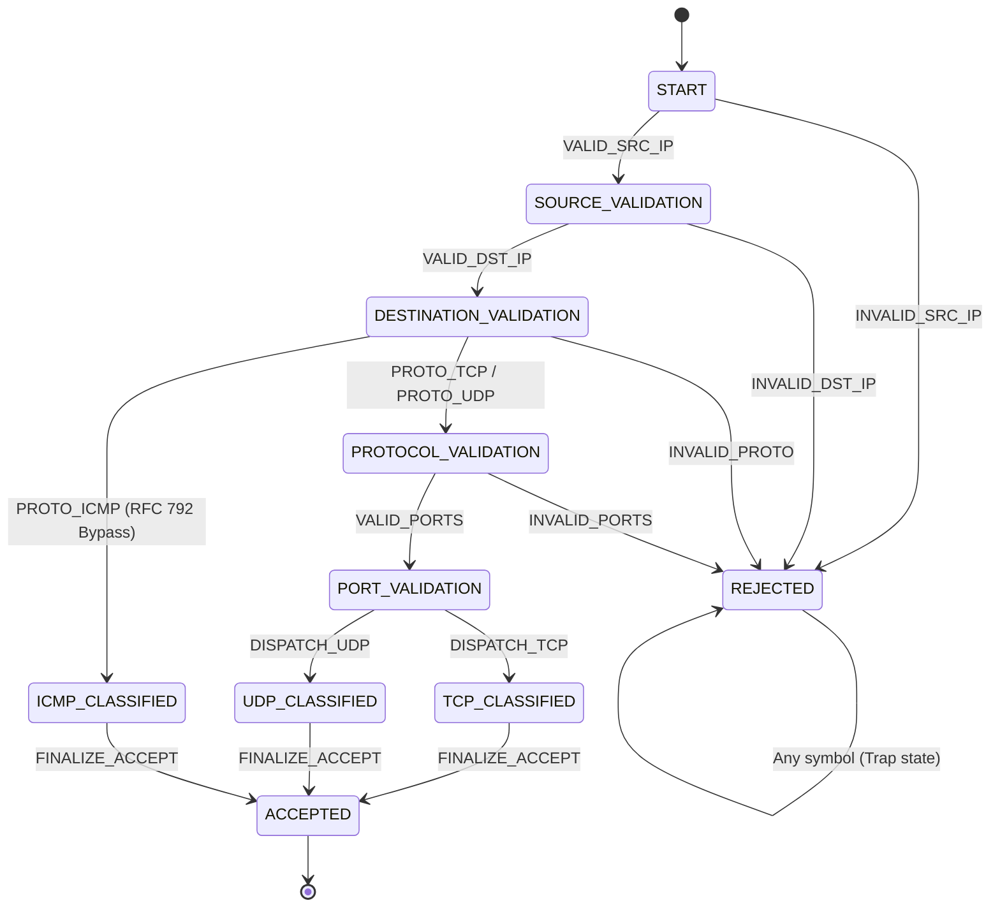

# Deterministic Finite Automaton (DFA) Formal Design

## 1. Formal Mathematical Specification

In formal automata theory, a Deterministic Finite Automaton (DFA) is defined as a 5-tuple:

$$M = (Q, \Sigma, q_0, F, \delta)$$

Where:
- $Q$ is the finite, non-empty set of internal states.
- $\Sigma$ is the finite, non-empty set of input alphabet symbols.
- $q_0 \in Q$ is the designated initial / start state.
- $F \subseteq Q$ is the set of final / accepting states.
- $\delta: Q \times \Sigma \to Q$ is the deterministic transition function mapping a state and an input symbol to exactly one unique next state.

---

## 2. Set of States ($Q$)

The automaton defines $|Q| = 10$ distinct, meaningful states representing each stage of network packet inspection:

$$Q = \{ \text{START}, \text{SOURCE\_VALIDATION}, \text{DESTINATION\_VALIDATION}, \text{PROTOCOL\_VALIDATION}, \text{PORT\_VALIDATION}, \text{TCP\_CLASSIFIED}, \text{UDP\_CLASSIFIED}, \text{ICMP\_CLASSIFIED}, \text{ACCEPTED}, \text{REJECTED} \}$$

### State Semantics and Classifications

| State Identifier | Category | Theoretical & Operational Role |
|---|---|---|
| `START` | Initial State ($q_0$) | Resting state awaiting packet input ingestion. |
| `SOURCE_VALIDATION` | Intermediate State | Source IPv4 address format and octet numerical ranges $[0, 255]$ have been verified. |
| `DESTINATION_VALIDATION` | Intermediate State | Destination IPv4 address format and octet numerical ranges $[0, 255]$ have been verified. |
| `PROTOCOL_VALIDATION` | Intermediate State | Protocol evaluated as TCP or UDP; awaits transport port range validation. |
| `PORT_VALIDATION` | Intermediate State | Source and destination transport port numbers validated within allowable bounds $[1, 65535]$. |
| `TCP_CLASSIFIED` | Classification State | Packet confirmed and classified as Transmission Control Protocol (TCP). |
| `UDP_CLASSIFIED` | Classification State | Packet confirmed and classified as User Datagram Protocol (UDP). |
| `ICMP_CLASSIFIED` | Classification State | Packet confirmed as Internet Control Message Protocol (ICMP); transport port checks bypassed per RFC 792. |
| `ACCEPTED` | Accepting State ($F$) | Packet has satisfied all syntactic, numerical range, and protocol criteria. |
| `REJECTED` | Trap / Sink State | Packet contains structural, range, or protocol errors; trap state consumes all subsequent symbols. |

---

## 3. Input Alphabet ($\Sigma$)

The alphabet $\Sigma$ consists of discrete classification events generated by the lexical and structural analysis of the input fields:

$$\begin{aligned}
\Sigma = \{ & \text{VALID\_SRC\_IP}, \text{INVALID\_SRC\_IP}, \\
           & \text{VALID\_DST\_IP}, \text{INVALID\_DST\_IP}, \\
           & \text{PROTO\_TCP}, \text{PROTO\_UDP}, \text{PROTO\_ICMP}, \text{INVALID\_PROTO}, \\
           & \text{VALID\_PORTS}, \text{INVALID\_PORTS}, \\
           & \text{DISPATCH\_TCP}, \text{DISPATCH\_UDP}, \\
           & \text{FINALIZE\_ACCEPT} \}
\end{aligned}$$

---

## 4. Initial State ($q_0$)

$$q_0 = \text{START}$$

The automaton begins processing at the `START` state upon receiving a packet record.

---

## 5. Set of Final Accepting States ($F$)

$$F = \{ \text{ACCEPTED} \}$$

The language accepted by the automaton, denoted $L(M)$, represents the set of all syntactically and logically valid network packets:

$$L(M) = \{ w \in \Sigma^* \mid \delta^*(q_0, w) \in F \}$$

---

## 6. Formal Transition Function ($\delta$)

The transition function is deterministic: for every pair $(q, \sigma) \in Q \times \Sigma$, there is at most one unique target state $q' \in Q$.

$$\begin{aligned}
\delta(\text{START}, \text{VALID\_SRC\_IP}) &= \text{SOURCE\_VALIDATION} \\
\delta(\text{START}, \text{INVALID\_SRC\_IP}) &= \text{REJECTED} \\
\delta(\text{SOURCE\_VALIDATION}, \text{VALID\_DST\_IP}) &= \text{DESTINATION\_VALIDATION} \\
\delta(\text{SOURCE\_VALIDATION}, \text{INVALID\_DST\_IP}) &= \text{REJECTED} \\
\delta(\text{DESTINATION\_VALIDATION}, \text{PROTO\_TCP}) &= \text{PROTOCOL\_VALIDATION} \\
\delta(\text{DESTINATION\_VALIDATION}, \text{PROTO\_UDP}) &= \text{PROTOCOL\_VALIDATION} \\
\delta(\text{DESTINATION\_VALIDATION}, \text{PROTO\_ICMP}) &= \text{ICMP\_CLASSIFIED} \\
\delta(\text{DESTINATION\_VALIDATION}, \text{INVALID\_PROTO}) &= \text{REJECTED} \\
\delta(\text{PROTOCOL\_VALIDATION}, \text{VALID\_PORTS}) &= \text{PORT\_VALIDATION} \\
\delta(\text{PROTOCOL\_VALIDATION}, \text{INVALID\_PORTS}) &= \text{REJECTED} \\
\delta(\text{PORT\_VALIDATION}, \text{DISPATCH\_TCP}) &= \text{TCP\_CLASSIFIED} \\
\delta(\text{PORT\_VALIDATION}, \text{DISPATCH\_UDP}) &= \text{UDP\_CLASSIFIED} \\
\delta(\text{TCP\_CLASSIFIED}, \text{FINALIZE\_ACCEPT}) &= \text{ACCEPTED} \\
\delta(\text{UDP\_CLASSIFIED}, \text{FINALIZE\_ACCEPT}) &= \text{ACCEPTED} \\
\delta(\text{ICMP\_CLASSIFIED}, \text{FINALIZE\_ACCEPT}) &= \text{ACCEPTED} \\
\delta(\text{REJECTED}, \sigma) &= \text{REJECTED} \quad (\forall \sigma \in \Sigma)
\end{aligned}$$

---

## 7. Deterministic State Transition Diagram

---

## 8. Theoretical Properties & Proof of Determinism

1. **Determinism:**
   For every state $q \in Q$ and input symbol $\sigma \in \Sigma$, $|\delta(q, \sigma)| \le 1$. There are no non-deterministic branches ($\epsilon$-transitions do not exist in $M$).
2. **Totality / Trap State Completeness:**
   Any invalid symbol or out-of-range value directs the machine to `REJECTED`. The `REJECTED` state is an absorbing trap state:
   $$\delta(\text{REJECTED}, \sigma) = \text{REJECTED} \quad \forall \sigma \in \Sigma$$
3. **Decidability:**
   Because all valid packet fields have finite bounds and sequential transitions terminate in at most 6 steps, the halting problem is trivially solved in $O(1)$ constant time for any packet.
