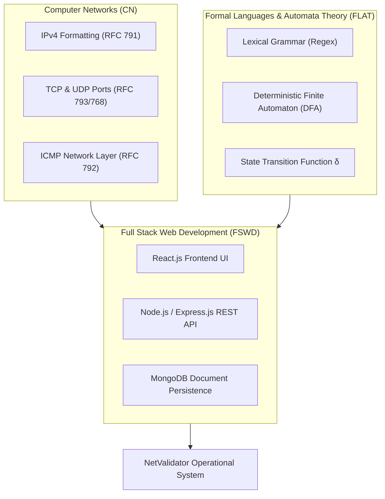

# Question No. 51 – Network Packet Format Validation and Classification System

## 1. Academic Assessment Metadata

| Field | Detail |
|---|---|
| **Question Number** | **51** |
| **Project Title** | **NETWORK PACKET FORMAT VALIDATION AND CLASSIFICATION SYSTEM** |
| **Candidate** | Third-Year B.Tech Information Technology Student |
| **Academic Year** | 2026–2027 (ODD Semester) |
| **Domain Integration** | Full Stack Web Development (FSWD) · Computer Networks (CN) · Formal Languages & Automata Theory (FLAT) |

---

## 2. Official Assigned Problem Statement

> *"Create a web application that accepts sample network packet records containing source address, destination address, protocol, and port information. Use regular expressions and validation rules to verify packet fields, and finite automata to classify packets according to predefined protocol patterns. Display valid and invalid packets, protocol classifications, and validation errors in a searchable interface."*

---

## 3. Academic Objectives

1. **Format Verification via Regular Expressions & Range Logic:**
   - Syntactically validate IPv4 addresses with regular expressions ensuring 4 octets separated by dots.
   - Enforce numerical octet bounds ($0 \le \text{octet} \le 255$).
   - Validate port numbers for transport layer protocols (TCP and UDP) ensuring integers in the range $[1, 65535]$.
   - Appropriately handle Internet Control Message Protocol (ICMP) network layer packets which do not utilize TCP/UDP transport ports according to RFC 792.
   - Deliver clear, human-understandable error messages when inputs fail validation.

2. **Deterministic Protocol Classification via Finite Automata:**
   - Implement a formal Deterministic Finite Automaton (DFA) defined mathematically by the 5-tuple:
     $$M = (Q, \Sigma, q_0, F, \delta)$$
   - Define exact discrete states: `START`, `SOURCE_VALIDATION`, `DESTINATION_VALIDATION`, `PROTOCOL_VALIDATION`, `PORT_VALIDATION`, `TCP_CLASSIFIED`, `UDP_CLASSIFIED`, `ICMP_CLASSIFIED`, `ACCEPTED`, `REJECTED`.
   - Process packet components sequentially through state transitions.
   - Record every transition step $(\text{fromState}, \text{inputSymbol}) \to \text{toState}$ and persist the execution trace in the database.

3. **Interactive & Searchable Full-Stack User Interface:**
   - Develop a responsive React.js single-page application with a cybersecurity network-monitoring aesthetic.
   - Provide a dynamic dashboard displaying total, valid, invalid, TCP, UDP, and ICMP packet counts dynamically calculated from database records.
   - Implement real-time packet submission with immediate validation feedback.
   - Provide an audit record table with keyword search (IP, protocol, classification) and multi-attribute filters.
   - Build a sample testing suite featuring all 8 assigned test vectors using RFC 5737 reserved documentation IP addresses.
   - Provide an interactive DFA visualizer featuring state transition diagrams, state metadata cards, and a step-by-step packet simulator.

4. **Persistent Database Architecture:**
   - Connect to MongoDB using Mongoose with automated local persistence fallback to ensure high availability.
   - Persist packet metadata, validation errors, DFA classifications, and chronological transition histories.

---

## 4. Interdisciplinary Course Integration

