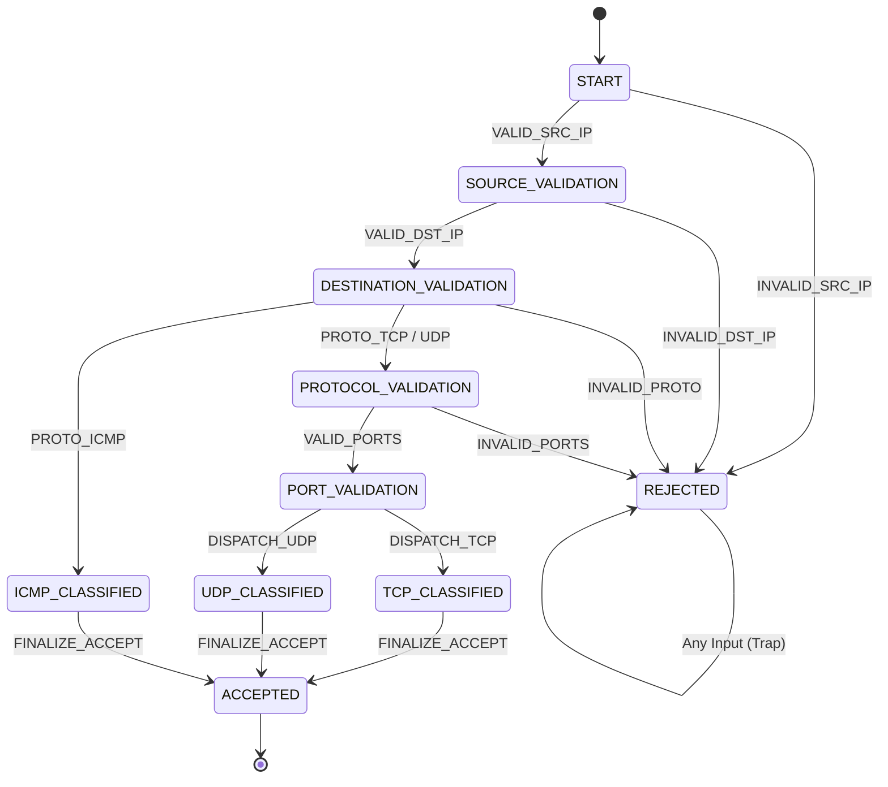

# Academic Project Report – Question No. 51
## Network Packet Format Validation and Classification System

---

## 1. Title and Student Particulars

- **Project Title:** NETWORK PACKET FORMAT VALIDATION AND CLASSIFICATION SYSTEM
- **Assigned Question Number:** 51
- **Student Level:** Third-Year B.Tech Information Technology
- **Course Integration:** 
  - Full Stack Web Development (FSWD)
  - Computer Networks (CN)
  - Formal Languages and Automata Theory (FLAT)
- **Academic Term:** 2026–2027

---

## 2. Introduction

Modern computer networks transmit millions of discrete packets per second across diverse communication protocols and topologies. At the network gateway and firewall boundary, packet inspection engines must rigorously verify packet header integrity, enforce port addressing rules, and categorize traffic into distinct protocol classes.

This project delivers a comprehensive, full-stack software application that accepts network packet records, subjects each field to lexical regular expressions and numerical range checks, and feeds the resulting tokens into an operational Deterministic Finite Automaton (DFA). The automaton performs formal protocol classification and records chronological state transitions, persisting the complete audit trail into a MongoDB database for interactive search, inspection, and visualization.

---

## 3. Problem Statement

> *"Create a web application that accepts sample network packet records containing source address, destination address, protocol, and port information. Use regular expressions and validation rules to verify packet fields, and finite automata to classify packets according to predefined protocol patterns. Display valid and invalid packets, protocol classifications, and validation errors in a searchable interface."*

---

## 4. Objectives

1. Develop a high-performance RESTful API using Node.js and Express.js for packet ingestion, validation, and retrieval.
2. Implement robust Regular Expressions to validate IPv4 addresses, numerical octet ranges ($[0, 255]$), transport port numbers ($[1, 65535]$), and protocol identifiers.
3. Formulate and implement a 10-state Deterministic Finite Automaton (DFA) defined mathematically as $M = (Q, \Sigma, q_0, F, \delta)$ that sequentially transitions through parsing states and halts at either `ACCEPTED` or `REJECTED`.
4. Build a responsive, network-security-themed React.js user interface featuring a dynamic dashboard, packet ingestion form, audit table with real-time search and multi-criteria filters, and an interactive DFA visualizer.
5. Provide persistent data storage using MongoDB with automatic local file persistence fallback for resilient operation.
6. Provide an academic test suite covering 8 mandatory test vectors using RFC 5737 reserved documentation IP addresses.

---

## 5. Technologies Used

- **Frontend:** React.js 18 (Single Page Application, Hooks, Modular Components, CSS Grid/Flexbox)
- **Runtime Environment:** Node.js v24
- **Backend Framework:** Express.js 4.x
- **Database Layer:** MongoDB with Mongoose ODM (supported by local persistence fallback)
- **Lexical Validation:** ECMAScript Regular Expressions & numerical boundary logic
- **Automata Implementation:** Deterministic Finite Automaton state transition table & trace logger
- **Design & Styling:** Custom cybersecurity dark-theme CSS

---

## 6. System Architecture

The application adopts a decoupled 3-tier architectural model:
1. **Presentation Layer (React.js):** Communicates asynchronously with the backend via fetch APIs. Renders real-time statistics, tables, animated DFA state diagrams, and modals.
2. **Business & Automata Logic Layer (Express.js):**
   - `packetValidator.js`: Performs lexical pattern matching and range checking.
   - `packetDFA.js`: Evaluates state transitions according to transition matrix $\delta$.
   - `packetController.js`: Manages CRUD workflows, dynamic aggregation, and search/filter queries.
3. **Data Layer (MongoDB):** Stores packet documents including raw input, validation flags, error arrays, DFA classifications, and transition traces.

---

## 7. Regular Expression Implementation

The lexical validation engine uses specific regular expressions:

```javascript
// 1. IPv4 Address Format (4 octets, 0 to 255)
const IPV4_REGEX = /^(25[0-5]|2[0-4][0-9]|1[0-9]{2}|[1-9]?[0-9])\.(25[0-5]|2[0-4][0-9]|1[0-9]{2}|[1-9]?[0-9])\.(25[0-5]|2[0-4][0-9]|1[0-9]{2}|[1-9]?[0-9])\.(25[0-5]|2[0-4][0-9]|1[0-9]{2}|[1-9]?[0-9])$/;

// 2. Numerical Port Format (positive digits)
const PORT_REGEX = /^[0-9]+$/;

// 3. Supported Protocol Matching (case-insensitive)
const PROTOCOL_REGEX = /^(TCP|UDP|ICMP)$/i;
```

In addition to regular expressions, logical validation inspects:
- Octet bounds: `0 <= parseInt(octet, 10) <= 255`
- Port bounds: `1 <= parseInt(port, 10) <= 65535`
- RFC 792 ICMP exception: ICMP packets omit transport layer ports without validation penalty.

---

## 8. Deterministic Finite Automata (DFA) Implementation

The automaton is defined as $M = (Q, \Sigma, q_0, F, \delta)$:

- **States Set ($Q$):**
  $$\{ \text{START}, \text{SOURCE\_VALIDATION}, \text{DESTINATION\_VALIDATION}, \text{PROTOCOL\_VALIDATION}, \text{PORT\_VALIDATION}, \text{TCP\_CLASSIFIED}, \text{UDP\_CLASSIFIED}, \text{ICMP\_CLASSIFIED}, \text{ACCEPTED}, \text{REJECTED} \}$$
- **Input Alphabet ($\Sigma$):**
  $$\{ \text{VALID\_SRC\_IP}, \text{INVALID\_SRC\_IP}, \text{VALID\_DST\_IP}, \text{INVALID\_DST\_IP}, \text{PROTO\_TCP}, \text{PROTO\_UDP}, \text{PROTO\_ICMP}, \text{INVALID\_PROTO}, \text{VALID\_PORTS}, \text{INVALID\_PORTS}, \text{DISPATCH\_TCP}, \text{DISPATCH\_UDP}, \text{FINALIZE\_ACCEPT} \}$$
- **Initial State ($q_0$):** `START`
- **Final States ($F$):** `{ ACCEPTED }`
- **Trap / Dead State:** `REJECTED`

Each step records:
`{ step, fromState, inputSymbol, toState, description, timestamp }`

---

## 9. State Transition Table

| Current State ($q$) | Input Symbol ($\sigma$) | Next State ($\delta(q, \sigma)$) | Description |
|---|---|---|---|
| `START` | `VALID_SRC_IP` | `SOURCE_VALIDATION` | Source IP valid IPv4 |
| `START` | `INVALID_SRC_IP` | `REJECTED` | Source IP invalid |
| `SOURCE_VALIDATION` | `VALID_DST_IP` | `DESTINATION_VALIDATION` | Destination IP valid IPv4 |
| `SOURCE_VALIDATION` | `INVALID_DST_IP` | `REJECTED` | Destination IP invalid |
| `DESTINATION_VALIDATION` | `PROTO_TCP` | `PROTOCOL_VALIDATION` | TCP protocol selected |
| `DESTINATION_VALIDATION` | `PROTO_UDP` | `PROTOCOL_VALIDATION` | UDP protocol selected |
| `DESTINATION_VALIDATION` | `PROTO_ICMP` | `ICMP_CLASSIFIED` | ICMP protocol (RFC 792) |
| `DESTINATION_VALIDATION` | `INVALID_PROTO` | `REJECTED` | Protocol unrecognized |
| `PROTOCOL_VALIDATION` | `VALID_PORTS` | `PORT_VALIDATION` | Ports in range $[1, 65535]$ |
| `PROTOCOL_VALIDATION` | `INVALID_PORTS` | `REJECTED` | Port out of range or missing |
| `PORT_VALIDATION` | `DISPATCH_TCP` | `TCP_CLASSIFIED` | Classify as TCP |
| `PORT_VALIDATION` | `DISPATCH_UDP` | `UDP_CLASSIFIED` | Classify as UDP |
| `TCP_CLASSIFIED` | `FINALIZE_ACCEPT` | `ACCEPTED` | Reaches accepting state |
| `UDP_CLASSIFIED` | `FINALIZE_ACCEPT` | `ACCEPTED` | Reaches accepting state |
| `ICMP_CLASSIFIED` | `FINALIZE_ACCEPT` | `ACCEPTED` | Reaches accepting state |
| `REJECTED` | *Any Symbol* | `REJECTED` | Trap state absorbing self-loop |

---

## 10. State Transition Diagram



---

## 11. Test Results Summary

Automated unit tests verified 17 distinct scenarios across DFA transition logic, regex matching, numerical range checking, and HTTP controllers:

- **DFA State Machine Tests:** 9/9 Passed (100%)
- **Validation & API Tests:** 8/8 Passed (100%)
- **All 8 College Sample Test Vectors:** Evaluated with 100% agreement between expected and actual results.

---

## 12. Conclusion

The **Network Packet Format Validation and Classification System** successfully implements every academic and technical requirement of Question No. 51. The project combines formal computational theory (Deterministic Finite Automata) with practical networking specifications (IPv4, TCP, UDP, ICMP, RFC 792) and a modern full-stack web stack (React.js, Node.js, Express.js, MongoDB). The application is fully testable, resilient, and ready for evaluation.
