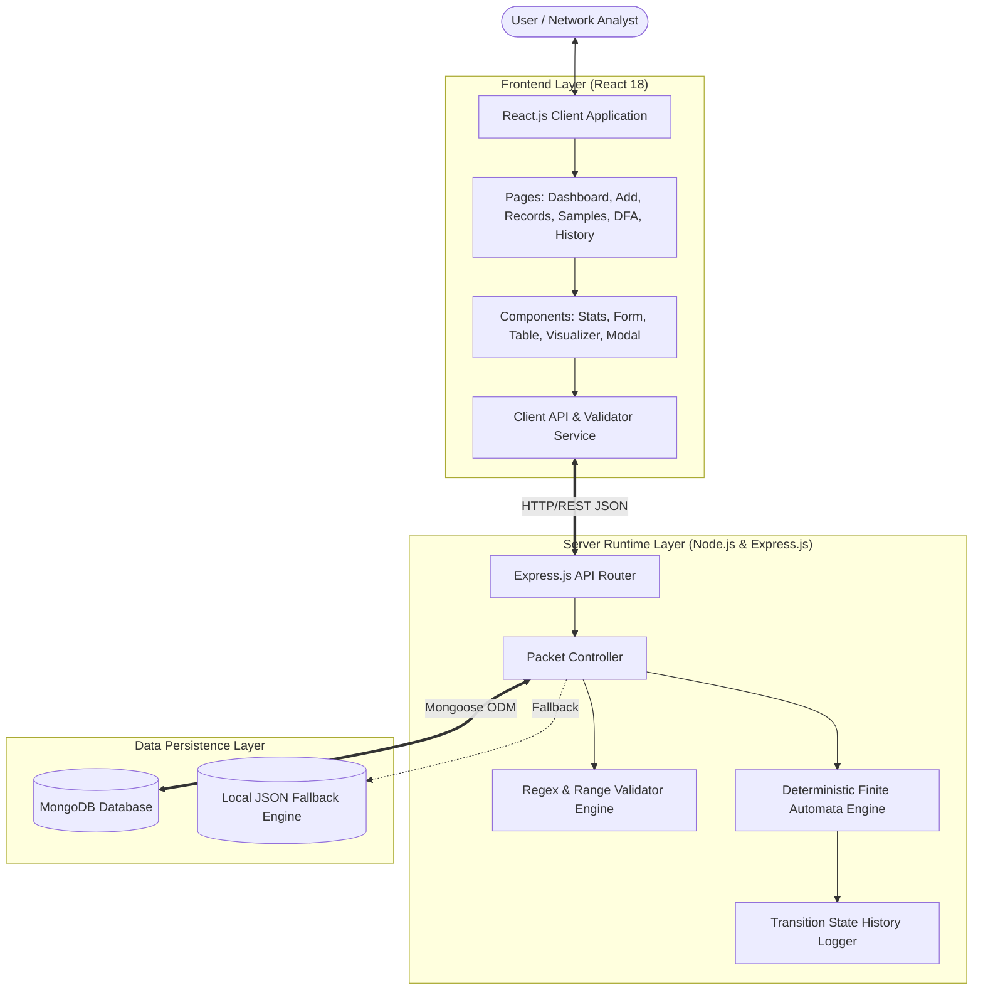
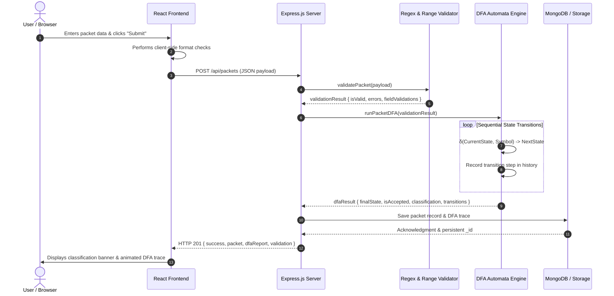

# System Architecture Specification

## 1. Architectural Overview

The **Network Packet Format Validation and Classification System (NetValidator)** is structured as a professional 3-tier full-stack architecture comprising a React.js client, a Node.js/Express.js backend server hosting the DFA automata engine, and a MongoDB database layer.

---

## 2. Component Communication & Lifecycle

1. **Client Request Dispatch:**
   - The user inputs packet fields (Source IP, Destination IP, Protocol, Source Port, Destination Port) or triggers one of the 8 predefined sample test cases.
   - The client-side validator executes immediate lexical checks. If inputs pass initial heuristics, an asynchronous HTTP POST request is dispatched to `/api/packets` with JSON payload.

2. **Backend Validation & Automata Processing:**
   - The Express server receives the request.
   - `packetValidator.js` executes rigorous JavaScript Regular Expressions:
     - `IPV4_REGEX` for 4-octet dot notation.
     - Numerical range verification: each octet $o_i \in [0, 255]$.
     - `PORT_REGEX` and numerical bounds $[1, 65535]$ for TCP and UDP.
     - RFC 792 bypass rule for ICMP packets (ports set to `null`).
   - The validation result is passed to `packetDFA.js`.
   - The DFA processes the packet through formal states starting at $q_0 = \text{START}$.
   - Every state transition step $(\text{fromState}, \text{inputSymbol}, \text{toState}, \text{description})$ is recorded in a chronological trace array.
   - The DFA terminates at either $\text{ACCEPTED} \in F$ or the trap state $\text{REJECTED}$.

3. **Database Ingestion & Response:**
   - The packet record, validation flags, DFA classification, and state transition history are saved to the MongoDB `packets` collection via Mongoose.
   - If MongoDB is unreachable, the system activates the local JSON persistence engine (`server/data/fallbackPackets.json`) to prevent system halts.
   - The controller returns a `201 Created` HTTP response containing the full saved record, validation report, and DFA execution trace.
   - The React client updates its state, displays the success/error banner, and animates the transition trace in the UI.

---

## 3. Sequence Diagram

---

## 4. RESTful API Endpoint Specifications

| Method | Endpoint | Description | Request Body | Response Format |
|---|---|---|---|---|
| `GET` | `/api/health` | Health & system status check | None | `{ status, database, academicDetails }` |
| `POST` | `/api/packets` | Ingests, validates, executes DFA & stores packet | `{ sourceIp, destinationIp, protocol, sourcePort, destinationPort }` | `{ success, packet, dfaReport, validation }` |
| `GET` | `/api/packets` | Search & filter packets with pagination | Query: `search, protocol, status, page, limit` | `{ success, count, total, page, packets: [...] }` |
| `GET` | `/api/packets/:id` | Fetch specific packet details by ID | Route param `:id` | `{ success, packet }` |
| `DELETE` | `/api/packets/:id` | Delete packet record by ID | Route param `:id` | `{ success, message }` |
| `GET` | `/api/stats` | Dynamic dashboard metrics from MongoDB | None | `{ success, stats: { total, valid, invalid, protocolDist, ... } }` |
| `GET` | `/api/samples` | List 8 RFC predefined sample test cases | None | `{ success, total: 8, samples: [...] }` |
| `POST` | `/api/samples/test/:id` | Execute live test of a specific sample | Route param `:id` | `{ success, sampleCase, savedPacket, dfaResult }` |
| `POST` | `/api/samples/reset` | Resets packet database to clean test seeds | None | `{ success, message, count }` |
| `GET` | `/api/automata` | Formal DFA definition and transition table | None | `{ success, automata: { states, alphabet, table, ... } }` |

---

## 5. Security & Defensive Design

1. **Input Sanitization:** All text inputs are automatically trimmed of extraneous whitespace to mitigate injection and formatting errors.
2. **Double-Layer Validation:** Full validation occurs on both the client (for instantaneous UX feedback) and backend (for authoritative security enforcement).
3. **Graceful High-Availability Storage:** If a remote or local MongoDB instance experiences disconnection, the local fallback engine maintains operations without throwing unhandled exceptions.
4. **Environment Isolation:** Database credentials and connection strings are managed exclusively via server-side `.env` files and never leaked to the client bundle.
